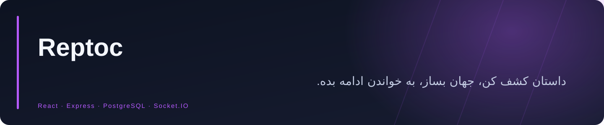

<div align="center">



**پلتفرم فارسی رمان و مانگا با فضای مطالعه و نویسندگی، امکانات اجتماعی، جهان‌سازی و مدیریت محتوا.**


<a href="https://github.com/Realjustawall/reptoc/actions/workflows/ci.yml"></a>

<a href="https://github.com/Realjustawall/reptoc/archive/refs/heads/main.zip"></a>
<a href="docs/gallery.fa.md"></a>
<a href="#quick-start"></a>
<a href="https://github.com/Realjustawall/reptoc/issues"></a>

[English](README.md) · [فارسی](README.fa.md)

</div>

---

[قابلیت‌های شاخص](#features) · [پیش‌نمایش](#preview) · [راه‌اندازی](#quick-start) · [توسعه](#development) · [مستندات](#documentation) · [امنیت و حریم خصوصی](#security) · [مجوز و بازخورد](#license)

<a id="features"></a>

## قابلیت‌های شاخص

| قابلیت | کاربرد |
|---|---|
| مطالعه | رمان، صفحات مانگا، نشانک، پیشرفت مطالعه و دریافت فصل برای مطالعهٔ آفلاین. |
| نویسندگی | محیط مدیریت رمان و فصل، ویرایش غنی، ابزار کاور و شخصیت. |
| جهان‌سازی | اطلاعات جهان، منابع، خط زمانی و ارتباط میان عناصر. |
| اجتماع | پروفایل کاربر و نویسنده، انجمن، چالش، دیدگاه و پیشنهاد اثر. |
| مدیریت | نظارت بر محتوا، آمار، ابزار پریمیوم و مدیریت مبتنی بر PostgreSQL. |

<a id="preview"></a>

## پیش‌نمایش

اطلاعات گالری نمایشی‌اند. صفحات وابسته به API با پاسخ آزمایشی محلی و صفحات آفلاین با دادهٔ نمونهٔ IndexedDB ثبت شده‌اند؛ حساب واقعی یا احراز هویت مبتنی بر PostgreSQL نمایش داده نمی‌شود.


<details>
<summary>تصاویر بیشتر</summary>


</details>

[مشاهدهٔ گالری کامل](docs/gallery.fa.md)

<a id="quick-start"></a>

## راه‌اندازی

از سرور تازهٔ اوبونتو ۲۲٫۰۴ یا ۲۴٫۰۴ و جدیدتر، یا دبیان ۱۲ و جدیدتر با دسترسی sudo استفاده کنید. حداقل ۲ گیگابایت رم لازم است؛ برای زمان ساخت، ۴ گیگابایت پیشنهاد می‌شود.

```bash
git clone https://github.com/Realjustawall/reptoc.git
cd reptoc
sudo ./install.sh
```

نصب‌کننده دامنه یا IP و حساب مالک را می‌پرسد، PostgreSQL را آماده می‌کند، مهاجرت‌ها و ساخت برنامه را انجام می‌دهد و سرویس و Nginx را تنظیم می‌کند. صدور گواهی HTTPS اختیاری است و به دسترسی شبکه و دامنه نیاز دارد. فایل موجود `/opt/reptoc/.env` بازنویسی نمی‌شود.

پیکربندی، پایگاه‌دادهٔ موجود، پشتیبان و نگهداری در [INSTALL.md](INSTALL.md) آمده است. استقرار و استفاده از پلتفرم به مجوز بیان‌شده در [LICENSE](LICENSE) نیاز دارد.

<a id="development"></a>

## توسعه

Node.js و npm و PostgreSQL لازم‌اند. پیش از اجرا، از `.env.example` کپی بگیرید و اتصال پایگاه‌داده و `ENCRYPTION_KEY` تصادفی و پایدار را تنظیم کنید.

```bash
cp .env.example .env
npm ci
# Configure .env and an empty development database first.
: "${DATABASE_URL:?Export the database URL configured in .env first}"
psql "$DATABASE_URL" -v ON_ERROR_STOP=1 -f postgres_schema.sql
psql "$DATABASE_URL" -v ON_ERROR_STOP=1 -f postgres_suggestion_schema.sql
npm run db:migrate
npm run dev
```

دستورهای بررسی:

```bash
npm run lint
npm run test:worldbuilding
npm run build
```

<a id="documentation"></a>

## مستندات

- [نصب و نگهداری](INSTALL.md)
- [راهنمای پیاده‌سازی](IMPLEMENTATION_GUIDE.md)
- [جهان‌سازی و پریمیوم](WORLDBUILDING_AND_PREMIUM.md)
- [نسخهٔ حفظ‌شدهٔ مستندات پیشین](REFERENCE.md)

<a id="security"></a>

## امنیت و حریم خصوصی

فایل `.env`، خروجی پایگاه‌داده، پیوست کاربران و پشتیبان عملیاتی را وارد Git نکنید. کلید رمزگذاری تصادفی و پایدار و پشتیبان جداگانهٔ PostgreSQL و پیوست‌ها نگه دارید. داده‌های نمایشی گالری، مدرک ممیزی امنیتی سامانهٔ عملیاتی نیستند.

<a id="license"></a>

## مجوز و بازخورد

این پروژه سورس‌در‌دسترس است و مجوز متن‌باز ندارد. استقرار یا بهره‌برداری پلتفرم، بازتوزیع و دیگر استفاده‌های محفوظ به اجازه نیاز دارند؛ [LICENSE](LICENSE) را بخوانید.

[گزارش اشکال و پیشنهاد بهبود](https://github.com/Realjustawall/reptoc/issues). نسخه، سیستم‌عامل و روش بازتولید را بنویسید و اطلاعات خصوصی یا رمزها را در گزارش قرار ندهید.

---

نگهداری توسط **[Realjustawall](https://github.com/Realjustawall)**.
