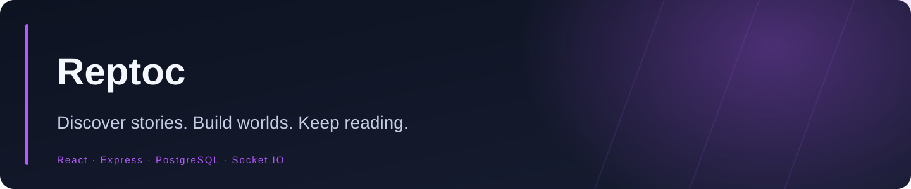

<div align="center">



**A Persian webnovel and manga platform with reading and writing workspaces, community features, worldbuilding and administration.**


<a href="https://github.com/Realjustawall/reptoc/actions/workflows/ci.yml"></a>

<a href="https://github.com/Realjustawall/reptoc/archive/refs/heads/main.zip"></a>
<a href="docs/gallery.en.md"></a>
<a href="#quick-start"></a>
<a href="https://github.com/Realjustawall/reptoc/issues"></a>

[English](README.md) · [فارسی](README.fa.md)

</div>

---

[Highlights](#features) · [Preview](#preview) · [Quick start](#quick-start) · [Development](#development) · [Documentation](#documentation) · [Security and privacy](#security) · [License and feedback](#license)

<a id="features"></a>

## Highlights

| Capability | What you get |
|---|---|
| Reading | Webnovels, manga pages, bookmarks, reading progress and offline chapter downloads. |
| Writing | Novel/chapter workspaces, rich editing, cover and character tools. |
| Worldbuilding | Structured lore, resources, timelines and relationships. |
| Community | Profiles, author pages, forums, challenges, comments and recommendations. |
| Operations | Moderation, analytics, premium tools and administration backed by PostgreSQL. |

<a id="preview"></a>

## Preview

The interface is currently Persian. Local preview data is fictional. API-backed gallery pages use local response fixtures; offline library/reader pages use seeded IndexedDB. No production account or PostgreSQL-backed authentication is demonstrated.

[Open the full gallery](docs/gallery.en.md)

[Browse the original Persian interface screenshots](docs/gallery.fa.md).

<a id="quick-start"></a>

## Quick start

Use a fresh Ubuntu 22.04/24.04+ or Debian 12+ server with sudo access. Allow at least 2 GB RAM; 4 GB is recommended during the build.

```bash
git clone https://github.com/Realjustawall/reptoc.git
cd reptoc
sudo ./install.sh
```

The installer asks for the domain/IP and owner account, provisions PostgreSQL, applies migrations, builds the app and configures the service/Nginx. HTTPS certificate setup is optional and requires the relevant domain/network access. It refuses to overwrite an existing `/opt/reptoc/.env`.

Read [INSTALL.md](INSTALL.md) for configuration, existing databases, backups and operations. Deployment and platform use require the permission described in [LICENSE](LICENSE).

<a id="development"></a>

## Development

Node.js/npm and a PostgreSQL database. Copy `.env.example`, configure database access and generate the required `ENCRYPTION_KEY` before startup.

```bash
cp .env.example .env
npm ci
# Configure .env and an empty development database first.
: "${DATABASE_URL:?Export the database URL configured in .env first}"
psql "$DATABASE_URL" -v ON_ERROR_STOP=1 -f postgres_schema.sql
psql "$DATABASE_URL" -v ON_ERROR_STOP=1 -f postgres_suggestion_schema.sql
npm run db:migrate
npm run dev
```

Validation commands:

```bash
npm run lint
npm run test:worldbuilding
npm run build
```

<a id="documentation"></a>

## Documentation

- [Installation and operations](INSTALL.md)
- [Implementation guide](IMPLEMENTATION_GUIDE.md)
- [Worldbuilding and premium](WORLDBUILDING_AND_PREMIUM.md)
- [Preserved documentation reference](REFERENCE.md)

<a id="security"></a>

## Security and privacy

Keep `.env`, database dumps, user uploads and runtime backups out of Git. Use a persistent random encryption key and maintain separate PostgreSQL/upload backups. The showcase uses demo API data and is not evidence of a production security audit.

<a id="license"></a>

## License and feedback

Source-available, not an open-source license. Deploying/operating a platform, redistribution and other reserved uses require permission; see [LICENSE](LICENSE).

[Report bugs or discuss improvements](https://github.com/Realjustawall/reptoc/issues). Include your version, OS and reproducible steps; keep credentials and private data out of reports.

---

Maintained by **[Realjustawall](https://github.com/Realjustawall)**.
