# Reptoc — گالری دمو

[README فارسی](../README.fa.md) · [English](../README.md)

اطلاعات گالری نمایشی‌اند. صفحات وابسته به API با پاسخ آزمایشی محلی و صفحات آفلاین با دادهٔ نمونهٔ IndexedDB ثبت شده‌اند؛ حساب واقعی یا احراز هویت مبتنی بر PostgreSQL نمایش داده نمی‌شود.

## کتابخانهٔ آفلاین

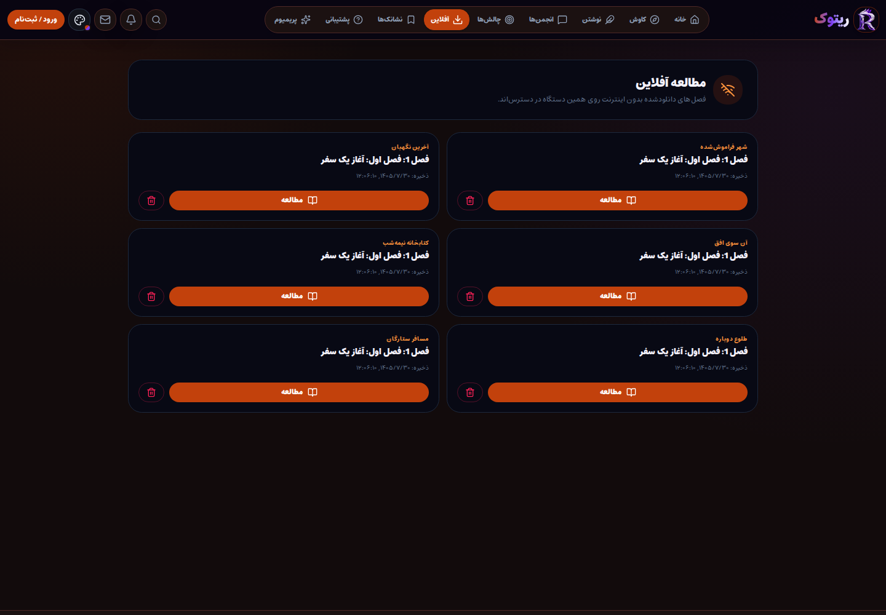

## مطالعهٔ آفلاین

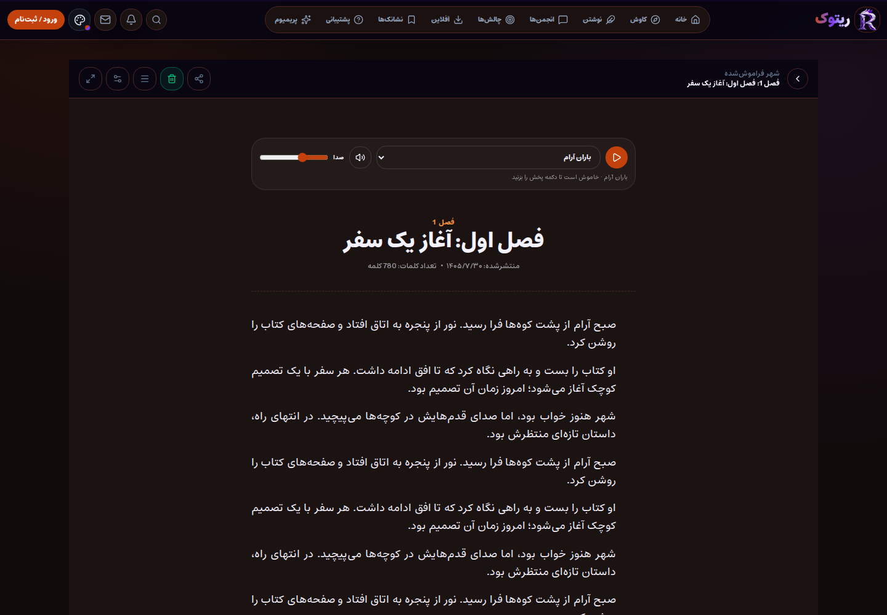

## خانه

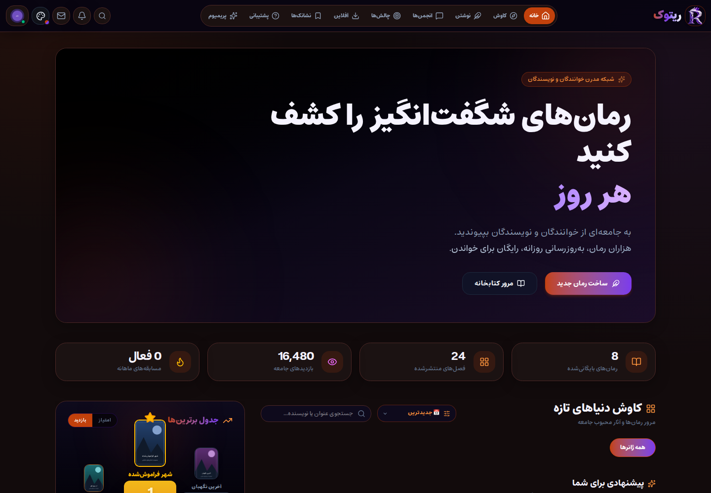

## مجموعه‌های منتخب

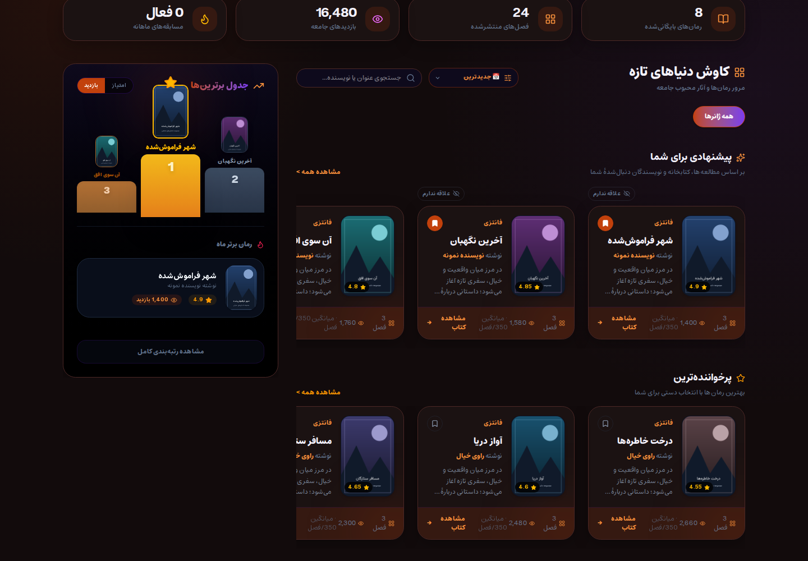

## کاوش آثار

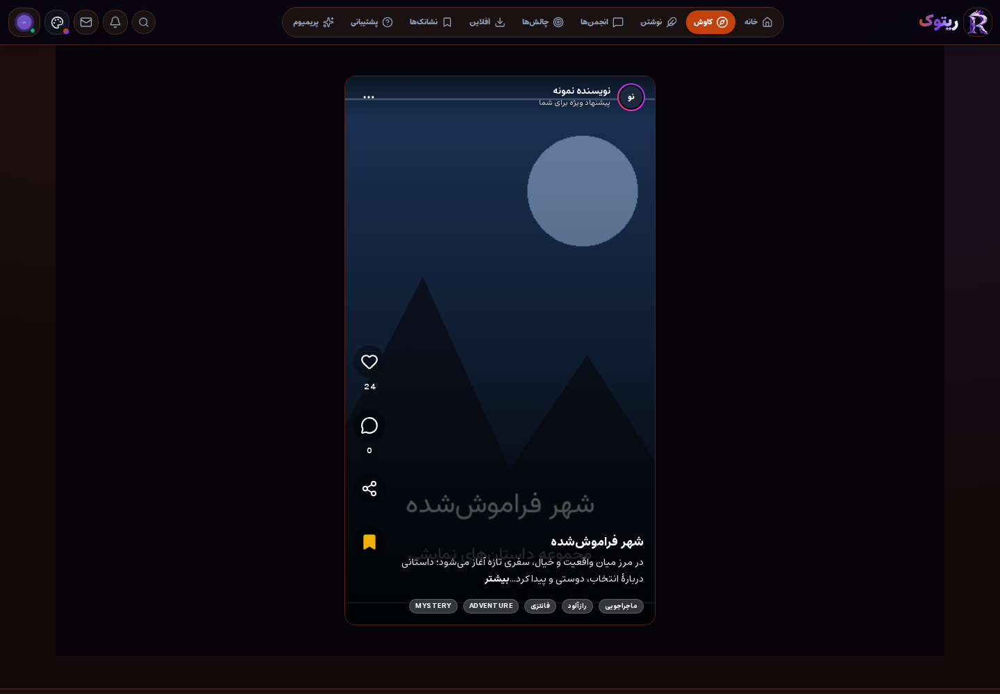

## جزئیات رمان

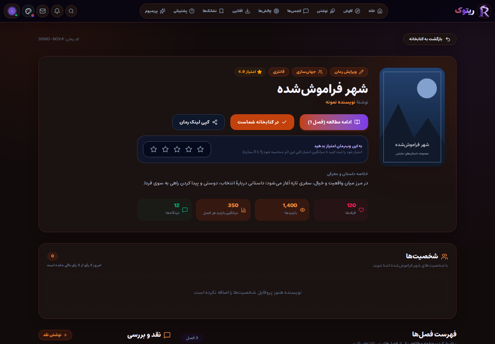

## مطالعه

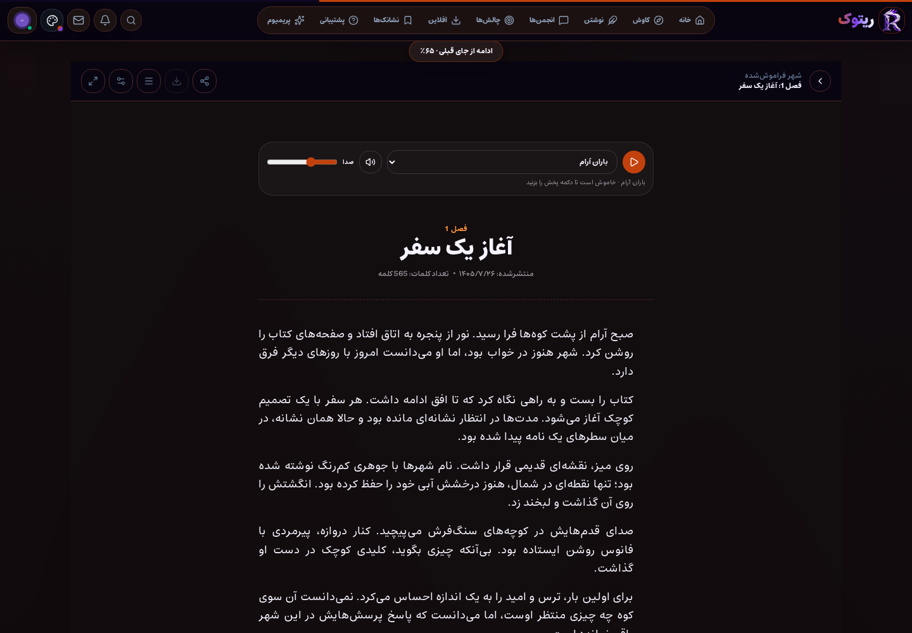

## پروفایل کاربری

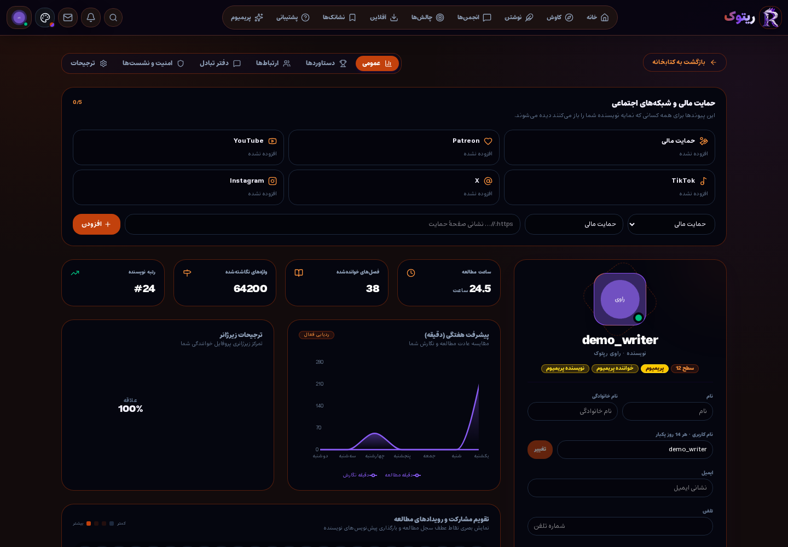

## تنظیمات مطالعه

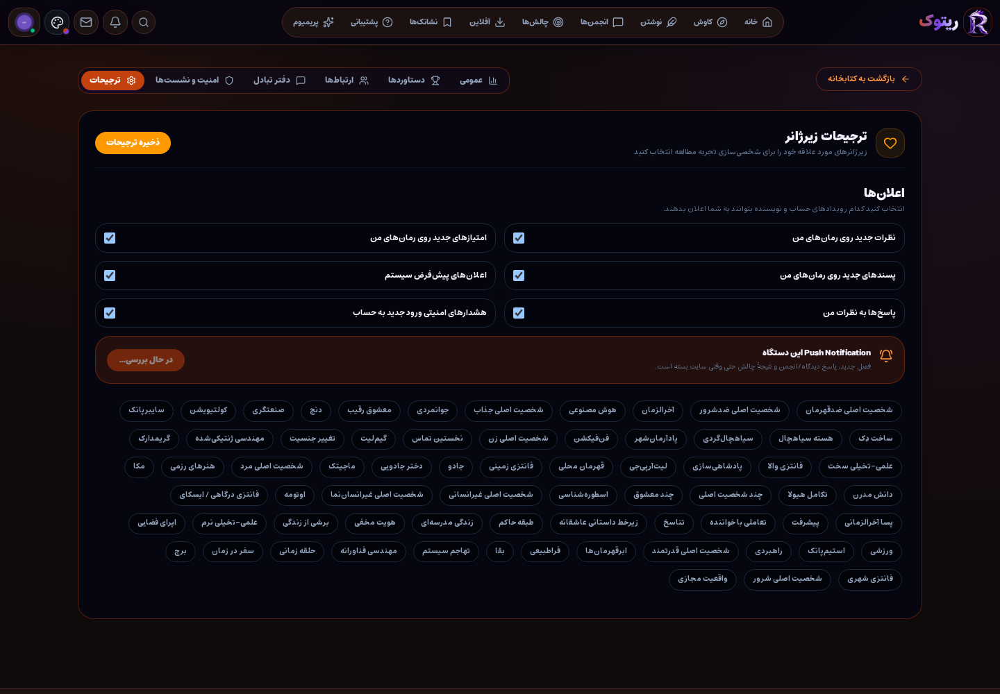

## کتابخانهٔ نشان‌شده‌ها

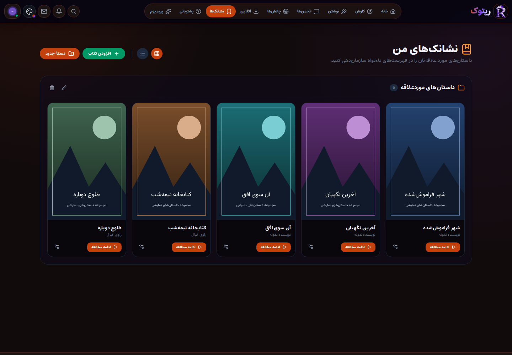

## میز کار نویسنده

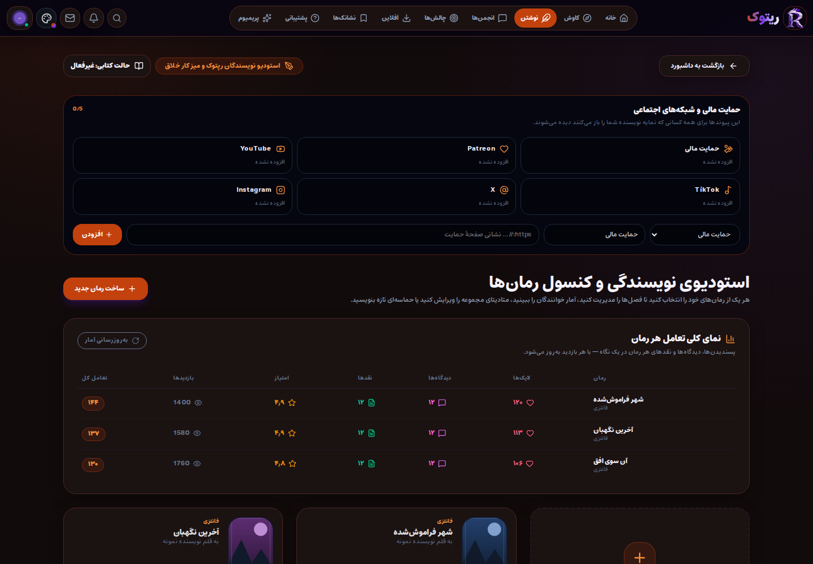

## ظاهر و پوسته‌ها

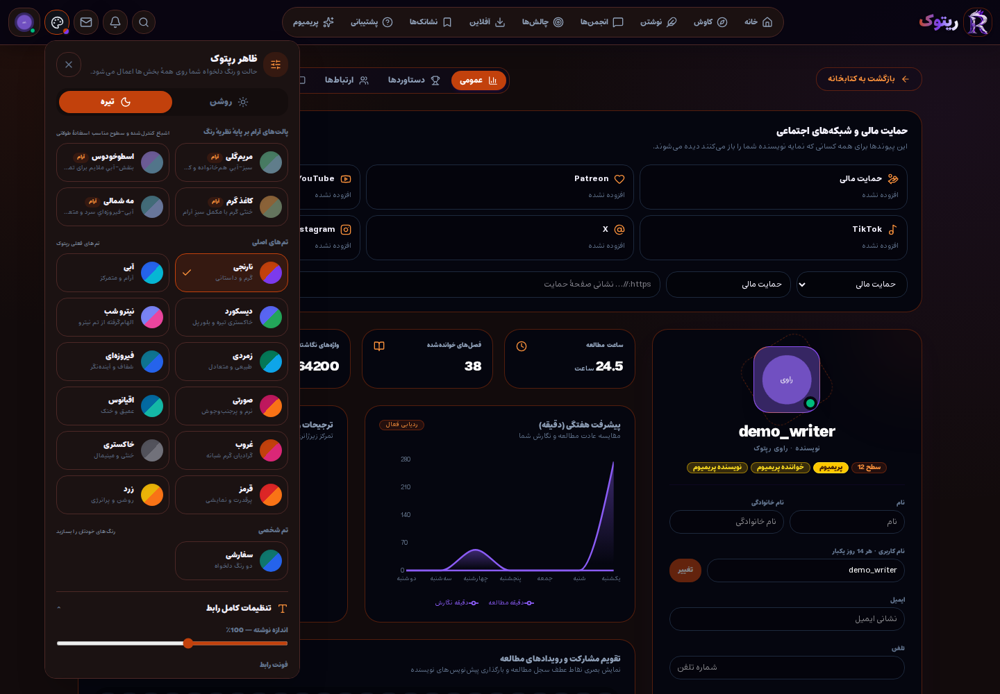

## پروفایل نویسنده

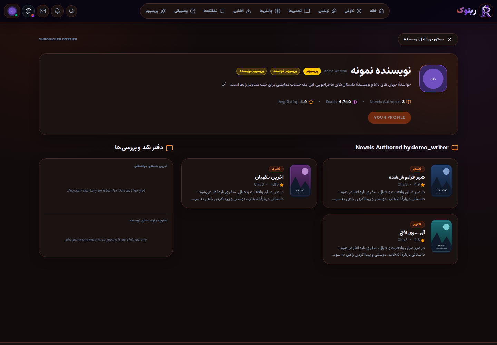

